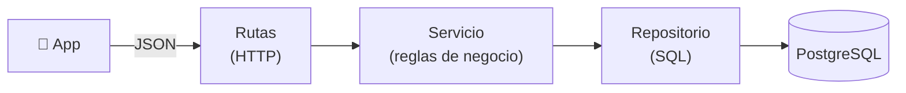

# NearHouse API

API REST de **NearHouse**, la aplicación de bienes raíces para Manzanillo, Colima. La app Android se comunica con esta API, y la API es la única que se conecta a la base de datos.


---

## Tecnologías

| Para qué | Tecnología |
|---|---|
| Lenguaje | Kotlin (JVM 21) |
| Framework web | Ktor 3 (servidor Netty) |
| JSON | kotlinx.serialization |
| Base de datos | PostgreSQL (alojada en Railway) |
| Conexiones a la BD | JDBC + HikariCP |
| Contraseñas | bcrypt (jBCrypt) |
| Autenticación | Tokens JWT |
| Desarrollo local | Docker y Docker Compose |
| Producción | Railway (sin Docker) |

---

## Cómo está organizada

Cada petición pasa por tres capas. Cada una tiene una sola responsabilidad:



- **Rutas** (`*Routes.kt`): reciben la petición, leen el JSON y responden. No tienen lógica.
- **Servicio** (`*Service.kt`): valida los datos, aplica las reglas (hashear contraseñas, generar tokens, revisar permisos).
- **Repositorio** (`*Repository.kt`): es el único que escribe SQL.

```
src/main/kotlin/com/equipo4/nearhouse/api/
├── Application.kt          # Punto de entrada: arranca el servidor y conecta todo
├── config/
│   ├── AppConfig.kt        # Lee las variables de entorno
│   └── DatabaseFactory.kt  # Pool de conexiones a PostgreSQL
├── plugins/                # Configuración de Ktor
│   ├── Serialization.kt    # JSON
│   ├── Monitoring.kt       # Logs de cada petición
│   ├── StatusPages.kt      # Convierte errores en respuestas JSON
│   ├── Security.kt         # Validación de tokens JWT
│   └── Routing.kt          # Registro de todas las rutas
├── common/                 # Errores y utilidades compartidas
├── auth/                   # JWT, hash de contraseñas y nombres de roles
└── usuarios/               # Módulo de usuarios (modelos, repositorio, servicio, rutas)
```

---

## Configuración

La API lee toda su configuración de variables de entorno. Copia la plantilla y llena los valores:

```bash
cp .env.example .env
```

| Variable | Qué es |
|---|---|
| `PORT` | Puerto de la API (`8080` en local) |
| `DB_URL` | Conexión JDBC: `jdbc:postgresql://HOST:PUERTO/railway` |
| `DB_USER` | Usuario de la base de datos |
| `DB_PASSWORD` | Contraseña de la base de datos |
| `JWT_SECRET` | Clave para firmar los tokens (mínimo 32 caracteres) |

Los datos de la base están en Railway, en la variable `DATABASE_PUBLIC_URL` del servicio de PostgreSQL. Las credenciales se comparten por mensaje privado; **el archivo `.env` nunca se sube a GitHub**.

---

## Ejecutar en local

### Con Docker (recomendado)

Necesitas Docker Desktop abierto.

```bash
docker compose up --build
```

La primera vez tarda varios minutos porque descarga Gradle y las dependencias. Cuando veas `Responding at http://0.0.0.0:8080`, la API está lista en `http://localhost:8080`.

Después de cambiar código o de hacer `git pull`, vuelve a ejecutar `docker compose up --build`.

### Desde IntelliJ IDEA (sin Docker)

1. Abre la carpeta del proyecto y espera a que Gradle sincronice. Usa el JDK 21 o uno más reciente.
2. Abre `Application.kt` y da clic en ▶️ junto a `fun main()`.
3. La primera vez fallará porque faltan las variables. Ve a **Run → Edit Configurations**, y en **Environment variables** pega los valores de tu `.env` separados por punto y coma:
   ```
   PORT=8080;DB_URL=jdbc:postgresql://HOST:PUERTO/railway;DB_USER=postgres;DB_PASSWORD=...;JWT_SECRET=...
   ```
4. Ejecuta de nuevo.

### Probar que funciona

Abre `http://localhost:8080/health` en el navegador. Debe responder:

```json
{ "estado": "ok", "baseDeDatos": "conectada" }
```

Para probar los demás endpoints, importa en Postman la colección `postman/NearHouse-API.postman_collection.json`. El login y el registro guardan el token automáticamente para usarlo en "Mi perfil".

---

## Endpoints

Base: `/api/v1`

| Método | Ruta | Requiere token | Descripción |
|---|---|---|---|
| GET | `/health` | No | Estado de la API y de la base de datos |
| POST | `/api/v1/auth/registro` | No | Crea una cuenta de Comprador |
| POST | `/api/v1/auth/login` | No | Inicia sesión y regresa un token |
| GET | `/api/v1/usuarios/me` | Sí | Datos del usuario que inició sesión |

### POST `/api/v1/auth/registro`

```json
{
  "correo": "ana@correo.com",
  "contrasena": "secreta123",
  "nombre": "Ana",
  "primerApellido": "López",
  "segundoApellido": "García",
  "telefono": "+523141234567"
}
```

- `segundoApellido` es opcional.
- `telefono` lleva el código de país seguido del número de 10 dígitos.
- La contraseña debe tener al menos 6 caracteres, igual que en la app.

Respuesta **201 Created**:

```json
{
  "token": "eyJhbGciOiJIUzI1NiIs...",
  "usuario": {
    "id": 2,
    "nombre": "Ana",
    "primerApellido": "López",
    "segundoApellido": "García",
    "correo": "ana@correo.com",
    "telefono": "+523141234567",
    "rol": "Comprador",
    "activo": true,
    "correoVerificado": false,
    "telefonoVerificado": false,
    "fechaRegistro": "2026-10-08T10:30:00.123Z"
  }
}
```

Errores posibles: **400** (datos inválidos) y **409** (correo o teléfono ya registrado).

### POST `/api/v1/auth/login`

```json
{
  "correo": "ana@correo.com",
  "contrasena": "secreta123"
}
```

Respuesta **200 OK**: el mismo formato que el registro (`token` y `usuario`).

Errores posibles: **401** (correo o contraseña incorrectos) y **403** (cuenta suspendida).

### GET `/api/v1/usuarios/me`

Encabezado obligatorio:

```
Authorization: Bearer <token>
```

Respuesta **200 OK**: el objeto `usuario`. Sin token, o con un token inválido o expirado, responde **401**.

### Formato de errores

Todos los errores tienen la misma forma, para que la app los muestre fácilmente:

```json
{
  "error": "Los datos enviados no son válidos",
  "detalles": [
    "El correo no tiene un formato válido",
    "La contraseña debe tener al menos 6 caracteres"
  ]
}
```

| Código | Significado |
|---|---|
| 400 | Datos inválidos o JSON mal formado |
| 401 | Falta iniciar sesión o el token no es válido |
| 403 | La cuenta no tiene permiso o está suspendida |
| 404 | No se encontró el recurso |
| 409 | El registro ya existe (correo o teléfono repetido) |
| 500 | Error interno del servidor |

---

## Despliegue en Railway

En producción Railway compila el proyecto con Gradle, sin Docker.

1. En el proyecto de Railway donde está PostgreSQL, agrega un servicio desde este repositorio de GitHub.
2. En **Settings → Build**, pon como comando de compilación:
   ```
   ./gradlew buildFatJar
   ```
3. En **Settings → Deploy**, pon como comando de inicio:
   ```
   java -jar build/libs/nearhouse-api-all.jar
   ```
4. En **Variables**, agrega (Railway asigna `PORT` solo):
   ```
   DB_URL      = jdbc:postgresql://${{Postgres.PGHOST}}:${{Postgres.PGPORT}}/${{Postgres.PGDATABASE}}
   DB_USER     = ${{Postgres.PGUSER}}
   DB_PASSWORD = ${{Postgres.PGPASSWORD}}
   JWT_SECRET  = <una clave larga y aleatoria, distinta a la de desarrollo>
   ```
   Usa los nombres reales de tu servicio de base de datos si no se llama `Postgres`.
5. En **Settings → Networking**, genera un dominio. Esa será la URL base de la app en producción.
6. Opcional: en **Settings → Deploy**, pon `/health` como ruta de healthcheck.

---

## Cómo agregar un módulo nuevo

Para un módulo como publicaciones, copia la estructura de `usuarios/`:

1. `PublicacionModels.kt`: clases `@Serializable` de lo que entra y sale.
2. `PublicacionRepository.kt`: las consultas SQL.
3. `PublicacionService.kt`: validaciones y reglas.
4. `PublicacionRoutes.kt`: una función `fun Route.publicacionRoutes(service: PublicacionService)`.
5. En `Application.kt`, crea el repositorio y el servicio, y pásalos a `configureRouting`.
6. En `plugins/Routing.kt`, agrega `publicacionRoutes(...)` dentro de `route("/api/v1")`.
